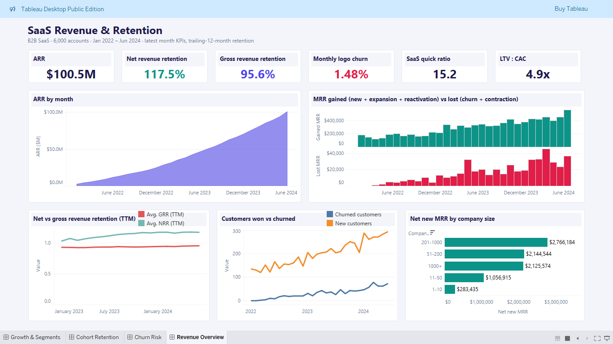
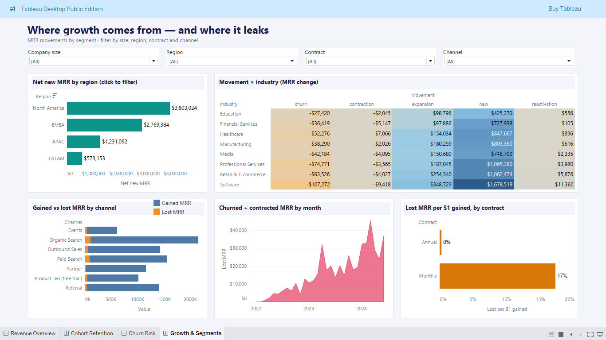
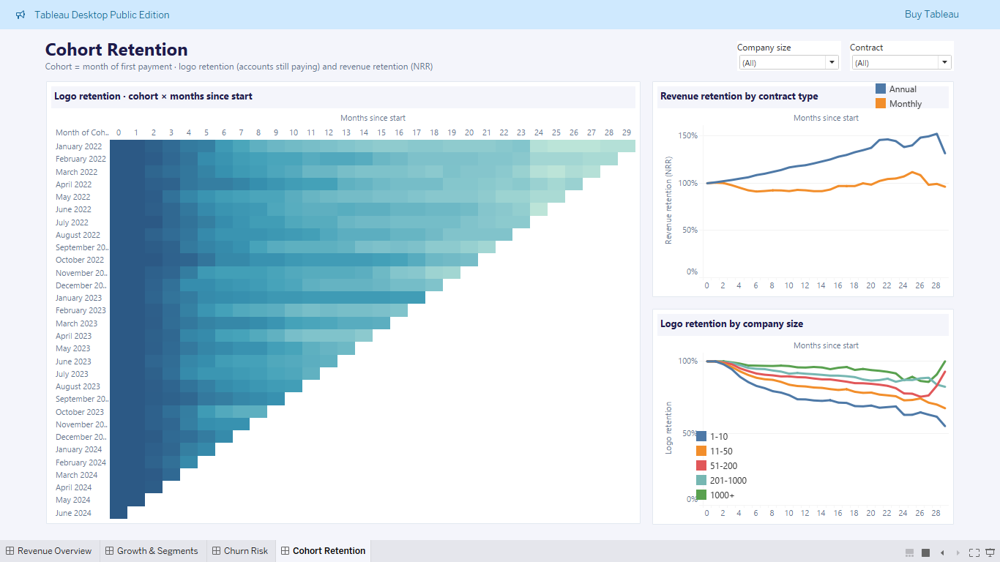
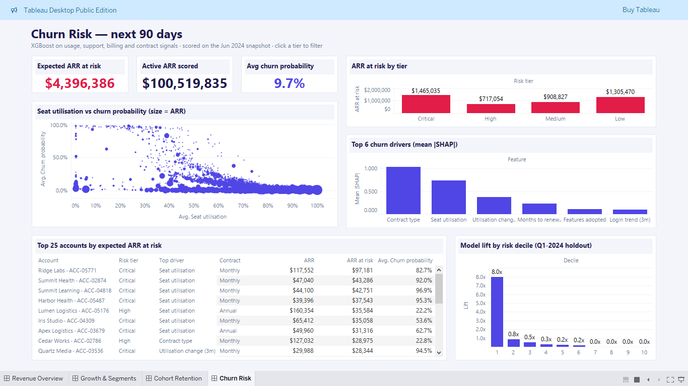

# SaaS Revenue, Retention & Churn Analytics


Revenue and churn analytics for a B2B SaaS company. A dbt + DuckDB warehouse calculates MRR, retention and
cohorts. An XGBoost model predicts which accounts will churn, and SHAP explains why. A Tableau workbook with
4 dashboards shows the results.

 
 
 




## Business problem
The company sells four seat-based plans on monthly and annual contracts. ARR grew from $11.7M to $100.5M in two
years. Leadership wants answers to four questions:

* Is growth healthy, or are we refilling a leaky bucket?
* Which segments, channels and contract types win or lose revenue?
* Do customers stay, and do they spend more over time?
* Which accounts will churn next quarter, and why?

## What's inside
* **Synthetic data** for billing, product usage, support tickets and NPS (30 months, 6,000 accounts).
* **dbt warehouse** in DuckDB with tested SaaS metrics.
* **Churn model** (XGBoost) with per-account explanations (SHAP).
* **Tableau workbook** with 4 dashboards: `tableau/SaaS Revenue and Churn.twbx`.

## Quick start
```bash
pip install -r requirements.txt
python run_pipeline.py      # generate data → dbt build → churn model → CSV export (a few minutes)
python -m pytest -q         # 6 checks on the results
```

Open `tableau/SaaS Revenue and Churn.twbx` in Tableau Desktop or Tableau Public. The workbook includes a
snapshot of the data. To show new pipeline results, point its data sources at the CSVs in `tableau/data/`
(see [docs/TABLEAU.md](docs/TABLEAU.md)).

## How it works
Flow: `data/landing/*.csv` → dbt → churn model → `tableau/data/*.csv` → Tableau. Details in
[docs/ARCHITECTURE.md](docs/ARCHITECTURE.md) and [docs/DATA_DICTIONARY.md](docs/DATA_DICTIONARY.md).

**dbt layers:**
* **Staging:** 7 views that clean and type the raw CSVs.
* **Intermediate:** one row per account per month, with each month's MRR change labelled (new, expansion, ...).
* **Marts:** monthly KPIs (MRR, ARR, NRR, GRR, LTV), MRR bridge, cohort retention, accounts, churn features.

**Data tests:** 31 dbt tests. Most check keys, nulls and allowed values. Two check business rules:
* `assert_mrr_bridge_reconciles`: opening MRR + net new MRR = closing MRR, every month.
* `assert_mrr_matches_billing_events`: warehouse MRR matches the billing system for every account.

**Churn model:**
* Target: the account stops paying within the next 3 months.
* 20 features: seat use, logins, support tickets, NPS, payment issues, months to renewal and company details.
* Out-of-time split: train up to Sep 2023, tune on Oct–Dec 2023, test on Jan–Mar 2024.
* SHAP gives each account its top 3 risk drivers, so customer success knows what to talk about.

## Tableau dashboards
| Dashboard | What it shows |
|---|---|
| **Revenue Overview** | KPI tiles, ARR trend, MRR gained vs lost, NRR vs GRR |
| **Growth & Segments** | net MRR by region, industry and channel; filters for size, region, contract, channel |
| **Cohort Retention** | retention heatmap and curves by contract and company size |
| **Churn Risk** | ARR at risk, risk tiers, SHAP drivers, top accounts to save |

|  |  |  |
|---|---|---|

## Results
*As of June 2024, the last full month of data.*

| Metric | Value |
|---|---|
| ARR | $100.5M (5,105 paying accounts, ARPA $1,641 / month) |
| Net revenue retention (TTM) | 117.5% |
| Gross revenue retention (TTM) | 95.6% |
| Monthly logo churn | 1.48% |
| LTV : CAC | 4.9x |
| Expected ARR at risk (next 90 days) | $4.4M |
| Churn model, test quarter (Q1 2024) | ROC-AUC 0.948 · PR-AUC 0.747 (base rate 4.6%) |
| Top 20% of risk scores | catch 88% of churners; top decile lift 8.0x |

**What it means:** growth is efficient, but monthly contracts leak. They keep 92.5% of their starting revenue
after 12 months, while annual contracts keep 119%. The main churn drivers are contract type, seat utilisation,
the 3-month usage trend and months to renewal. Suggested action: move monthly accounts with falling usage onto
annual plans early.

## Project structure
```
saas-churn_analytics_tableau/
├── run_pipeline.py          # runs all stages in order
├── src/
│   ├── config.py            # paths, seed, logging
│   ├── generate.py          # synthetic data → data/landing/
│   ├── churn_model.py       # XGBoost, SHAP, risk scores
│   └── export_tableau.py    # warehouse → tableau/data/*.csv
├── dbt/                     # models (staging, intermediate, marts), tests, macros
├── data/                    # landing CSVs and saas.duckdb
├── models/                  # churn_xgb.json, metrics.json
├── tableau/
│   ├── SaaS Revenue and Churn.twbx
│   ├── data/                # CSVs exported by the pipeline
│   └── screenshots/
├── tests/test_pipeline.py   # 6 pytest checks
└── docs/                    # ARCHITECTURE, DATA_DICTIONARY, TABLEAU
```

## Limitations & next steps
* **Synthetic data.** Signals are cleaner than in real life. On real data, expect a lower ROC-AUC (about 0.75–0.85).
* **Monthly batch.** No daily or real-time data.
* **Manual Tableau refresh.** After a pipeline run, the workbook must be pointed at the new CSVs.
* **Next step:** test retention offers and model who can be *saved*, not only who is *at risk*.

---
All data is synthetic. No real company or customer data is used.

**Series:** [2023 · E-commerce analytics (Power BI)](../project1_ecommerce_analytics) → **2024 · SaaS revenue &
churn (Tableau)** → [2025 · Supply-chain digital twin](../project3_supply_chain_twin) →
[2026 · Agentic fraud intelligence](../project4_fraud_detection)
