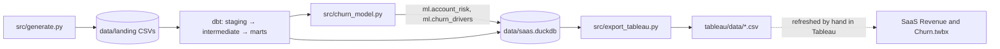

# Architecture

## Context
| | |
|---|---|
| **Domain** | B2B SaaS, seat-based plans (Starter $15 · Growth $29 · Business $49 · Enterprise $79 per seat / month) |
| **History** | Jan 2022 to Jun 2024 (30 months), 6,000 accounts |
| **Stack** | Python · DuckDB · dbt-duckdb · XGBoost · SHAP · Tableau |

## Data flow

## Synthetic data
Each account gets a hidden "product fit" score. It drives seat use, logins, support tickets, NPS and payment
issues, and the chance of expansion, contraction or churn. Usage drops for 1–3 months before an account churns,
so there is a signal to find. Annual contracts can only churn at renewal. `_ground_truth.csv` keeps the hidden
score so the model's drivers can be checked.

## Key decisions
| Decision | Why |
|---|---|
| DuckDB + dbt | runs on a laptop; the SQL can move to Snowflake or BigQuery |
| One row per account per month | churn is a missing payment, so every month must exist to see it |
| MRR changes from monthly snapshots | the MRR bridge must match billed revenue |
| Mid-month changes bill from the next cycle | found by the billing reconciliation test |
| NRR / GRR on a trailing 12 months | standard definitions; GRR caps each account at its old MRR |
| Churn label is empty when the 3 months are not over | prevents label leakage |

## Model
* XGBoost with early stopping, trained with an out-of-time split (train, validate, test on a later quarter).
* Outputs per account: churn probability, risk tier (Critical ≥ 30%, High ≥ 15%, Medium ≥ 7%),
  ARR at risk (ARR × probability) and the top 3 SHAP drivers.

## Quality checks
| Check | Where |
|---|---|
| Keys, nulls, allowed values, relationships | dbt schema tests |
| MRR bridge reconciles every month | dbt singular test |
| Warehouse MRR matches billing events | dbt singular test |
| Plausible retention, no label leakage, model beats random | pytest |
